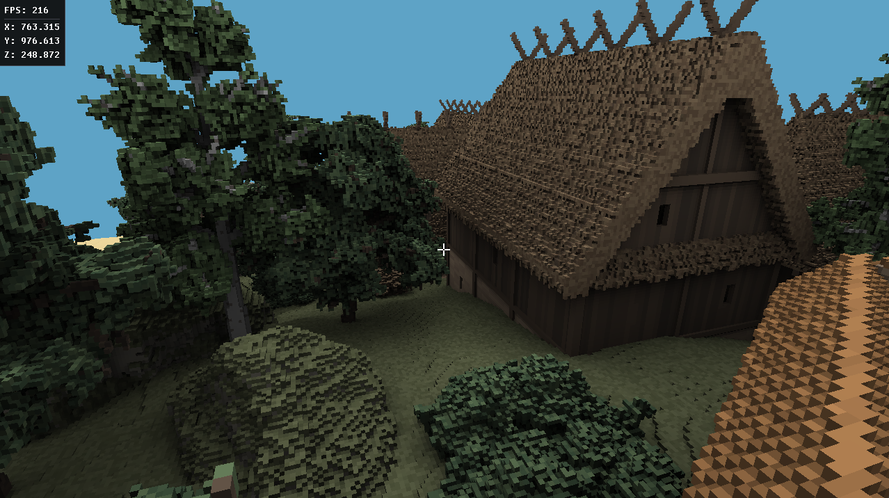
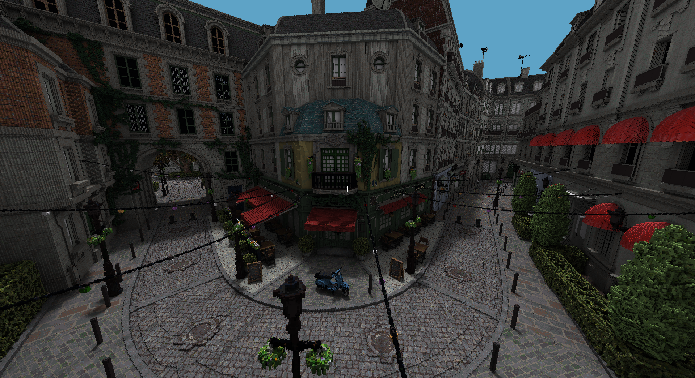
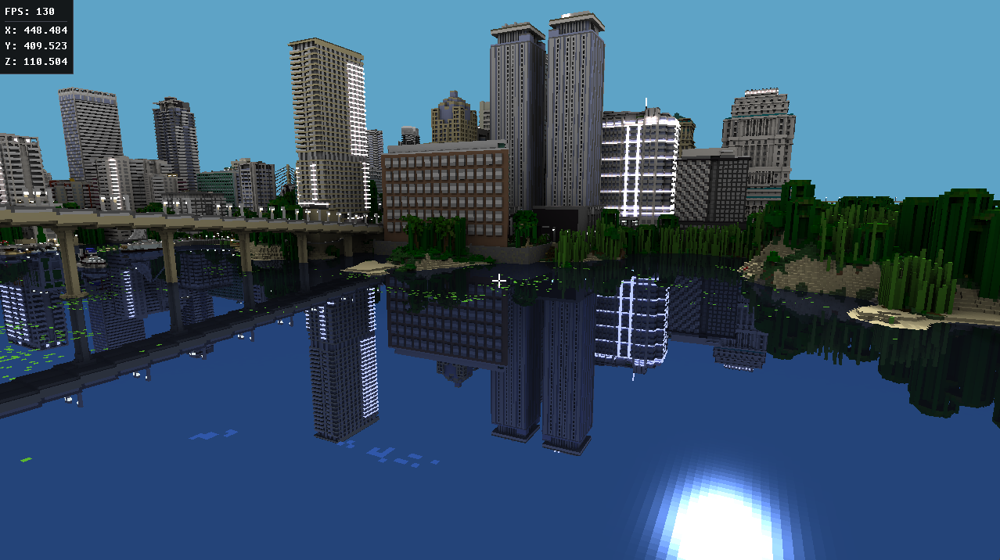
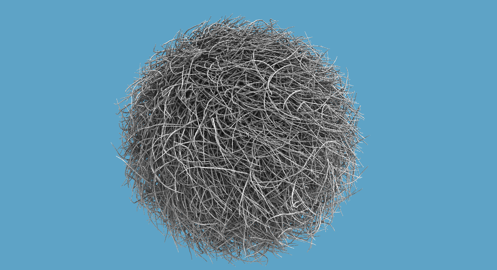
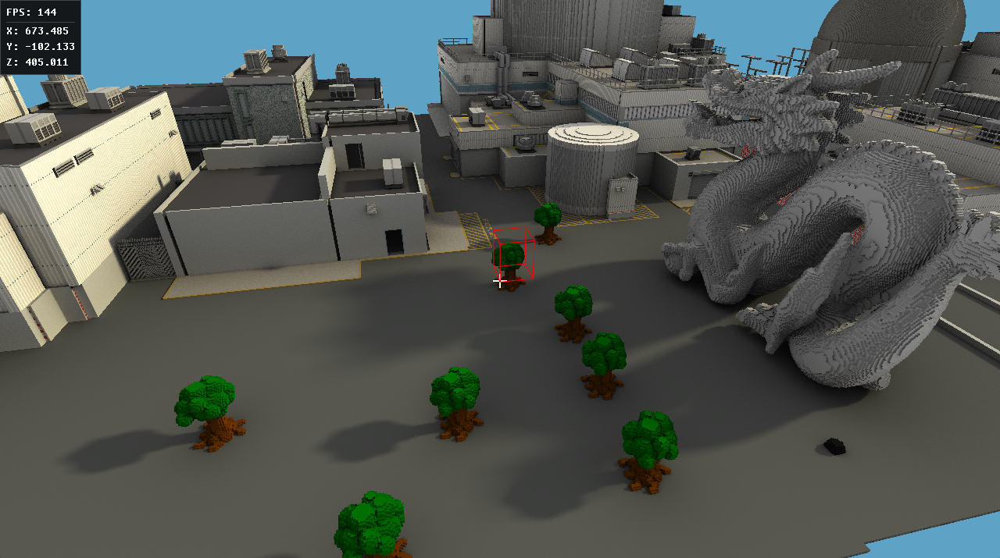
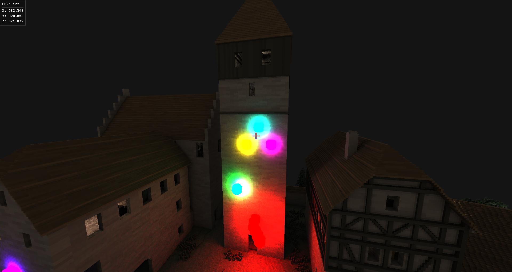
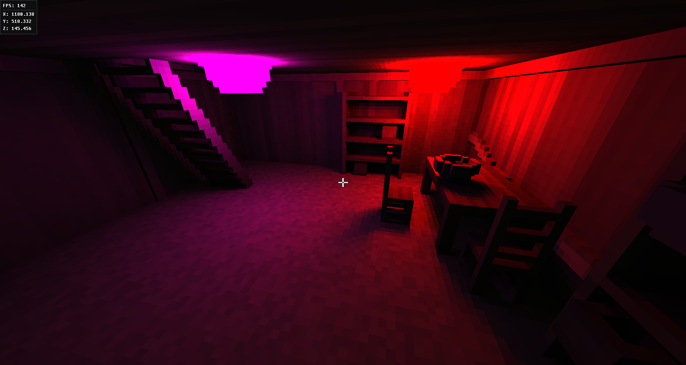
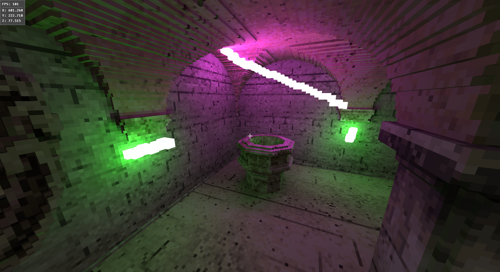

# Real-time ray traced voxel rendering using Vulkan

The implemented renderer uses a ray marching algorithm and sparse voxel trees along with a path-tracing based technique to render large-scale voxel scenes in real-time. The engine is implemented in C++ using the Vulkan API and supports dynamic lighting and shadows, ambient occlusion, specular reflections and interactive editing of the voxel environment. 

## Features

- **Rendering technique**: The engine uses ray marching on a sparse 4^3 tree to render voxels.
- **Editable environment**: The demo allows the user to place new voxels and delete/replace existing voxels.
- **Dynamic lighting and shadows**: Responsive lighting and shadows are computed in real-time. Light-emitting voxels act as light sources.
- **Diffuse lighting**: Path-traced diffuse lighting and AO which accumulates over many frames.
- **Directional sun light**: Sun light and soft shadows from a directional light source.
- **Specular lighting**: Simulates specular reflections using one ray per pixel.
- **User interface**: A graphical user interface, which displays information, allows the user to change rendering parameters and edit the color palette.
- **Model loading**: Supports loading voxel environments and models stored in the MagicaVoxel (.vox) format.


## Building

### Prerequisites

- A C++ compiler
- CMake (version 3.16 or higher)
- Vulkan SDK
- Git

### Steps

#### 1. Clone the repository:
```bash
git clone https://github.com/joszker/voxel-thesis.git
cd voxel-thesis
```

#### 2. Generate build files using CMake:
```bash
mkdir build && cd build
cmake ..
```

#### 3. Build the project (using CMake or Visual Studio):
```bash
cmake --build --preset Release
```

#### 4. Run the demo (from the root directory or by using Vistual Studio):
```bash
./build/Release/VxDemo
```

## Preview








